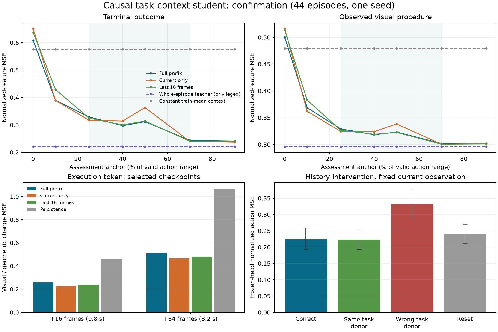

# Causal task-context student: implementation and measured results

Date: 2026-10-20. Status: causal representation milestone implemented, trained,
confirmed, and exported. **Useful prefix information: passed. Advantage from
longer history over a trained 16-frame control: not established.**

The student can infer useful non-text task context before episode completion.
This result supports the teacher/student representation path. It does not yet
justify replacing ALIGN's deployed intent branch, switching its backend to
TTT, or using belief confidence to trigger takeover. No controller was changed.

## What was built

- [Causal Mamba encoder](../models/task_context_encoder.py): two width-256
  Mamba1 blocks, four Gaussian hypotheses over four 128-D task tokens, and a
  separate 128-D execution token. There are 3,972,760 trainable parameters.
- [Prefix cache and loader](../data/task_context_prefix_dataset.py): frame-local
  frozen teacher summaries, split-preserving privileged labels, train-only
  latent normalization, and 16 uniform training anchors. All intervening
  observations update recurrence. Missing event/handover annotations are explicit.
- [Training](../training/train_task_context_encoder.py),
  [paired assessment](../tools/assess_task_context_encoder.py),
  [portable observer](../models/task_context_observer.py),
  [confirmation-bound export](../tools/export_task_context_observer.py), and
  [real-stream verification](../tools/verify_task_context_observer.py).
- [Reproduction and streaming instructions](../tools/README_task_context_encoder.md).

The task representation is learned from the completed demonstration teacher's
observed outcome and realized procedure. There is no hand-labelled embedding
GT. Four Gaussian modes express possible teacher-token vectors rather than four
predefined task classes. They are not guaranteed to correspond to calibrated
alternatives. Inference uses the top-weight mode; teacher assignment is never
available for evaluation or streaming.

Inputs are the frozen 256-D observation summary: two camera CLS features and
2×2 patch summaries, geometric robot state, and elapsed time. Text, task IDs,
current target actions, future frames, full teacher tokens, normalized progress,
and total episode duration are not learned inputs. Lengths only mask padding.
The legacy previous-action gripper fallback remains a command-history signal,
not a measured gripper or verified raw human command. The frozen teacher had
used offline task-group labels during its own training; this is not a wholly
label-free experiment.

The execution token predicts CLS and geometric-state changes at +16/+64 frames
(0.8/3.2 s). Unavailable future targets are masked. It has no ground truth for
contact, physical readiness, successful completion, or takeover eligibility.

## Fixed experiment and selection

The [teacher milestone](task_context_teacher_results_2026_10_20.md) supplied a
frozen teacher and target space. We reused 340 training, 44 development, and
44 confirmation episodes from the ten known LIBERO Goal groups. Confirmation
had already been characterized for the teacher; it stayed out of student
training and selection. This is an episode split, not a new scene/session/task
generalization benchmark.

An initial 100-update profile took 6.37 s including validation and peaked at
287.8 MiB of allocated GPU memory. An initial 100-epoch full-prefix run exposed
a selector problem: the best development checkpoint's top-mode latent MSE was
0.4811 while oracle-best candidate MSE was 0.2504. Dividing joint mixture NLL
by latent width 512 also suppresses the selector's gradient by 512.

Before opening student confirmation, we added 0.2 detached-posterior
responsibility cross entropy for the weights. This rescales selector learning
without adding task-class inputs or averaging incompatible token means.
Balanced indistinguishable-prefix toy tests retain both outcomes and balanced
weights. That test verifies the objective's capacity, not real-world ambiguity
calibration. The original run and source snapshot are retained.

The revised full, current-only, and 16-frame arms each received 100 epochs /
4,300 updates, batch eight episodes, 16 anchors, seed 42, AdamW 1e-4, and the
same architecture, normalization, supervision, and loss weights. The loss was
mixture NLL + 0.2 execution loss + 0.2 frozen outcome-decoder loss + 0.2 selector
loss. Auxiliary outcome training uses a teacher-target responsibility to choose
a **student-predicted** mean. The teacher/summary/decoders remain frozen; no
action-head imitation or diffusion fine-tuning occurs in this milestone.

Checkpoint selection minimized development mean latent/terminal/procedure/state
MSE using top-weight modes. Selected epochs were full **20**, current **100**,
short **45**; each completed the same total training budget. Full/current/short
runs took about 229/247/247 s, with peak allocations 288.7/267.1/307.0 MiB.
Runs shared a GPU with another active workload, which was left intact.

The [original protocol](../reports/task_context_student_20261020/protocol.json),
[selector revision](../reports/task_context_student_20261020/protocol_selector.json),
and [checkpoint lock](../reports/task_context_student_20261020/selection.json)
preceded student confirmation. The
[development report](../reports/task_context_student_20261020/development_selector_seed42.json)
passed the information gate and failed the longer-history gate. Confirmation
then used those exact checkpoint hashes, without retuning.

## Confirmation: useful information before episode completion

These are means over 44 confirmation episodes and four analysis anchors at
25%, 40%, 50%, and 70% of the valid action-anchor range. Fractions select
evaluation observations only. They are not network features or annotated
handover stages. Smaller MSE is better.

| Context supplied to frozen diagnostic decoders | Terminal visual MSE | Visual procedure MSE | Geometric procedure MSE | Normalized action MSE |
|---|---:|---:|---:|---:|
| Constant train-mean tokens | 0.57549 | 0.47944 | 0.81750 | 0.41364 |
| Current-only student | 0.30862 | 0.32184 | 0.15399 | 0.22843 |
| Last 16 frames student | **0.29491** | **0.31720** | **0.13527** | 0.22492 |
| Full-prefix student | 0.29543 | 0.31808 | 0.13948 | **0.22456** |
| Whole-episode teacher, privileged | 0.22082 | 0.29611 | 0.06511 | 0.19798 |

The full student reduces terminal error by **48.7%** and visual procedure error
by **33.7%** versus constant context. Paired absolute benefits and 95% episode
bootstrap intervals are 0.28006 [0.23305, 0.32391] and 0.16136
[0.14121, 0.18213]. It retains **79.0% / 88.0%** of the teacher-over-constant
terminal/procedure benefit, exceeding the predeclared 50% requirement.

The student is not uniformly informative at every prefix. At the first frame,
terminal/procedure errors are 0.60797/0.49989, worse than constant context.
At the 10% anchor they fall to 0.38987/0.36884; at 70% they reach
0.24329/0.30179. This does not establish a safe intervention time. Top-mode
normalized latent MSE at middle anchors is 0.23701 versus an oracle-best
candidate's 0.17660; candidate selection remains imperfect. All four modes are
used across confirmation anchors: [90, 98, 32, 88]. Entropy is not calibration.

## History is used, but long history has not earned its complexity

At the same current summary, incompatible donor history raises normalized
frozen-head action MSE from 0.22456 to 0.33233. Compared with same-task donor
history, the harm is **0.10921**, CI [0.07561, 0.14487]. Resetting this same
student's history also worsens terminal, procedure, and action predictions.
This establishes history sensitivity in the trained encoder.

It does **not** establish an advantage over independently trained controls:

| Full-prefix gain relative to independently trained control | Current only | Last 16 frames |
|---|---:|---:|
| Terminal error reduction | 4.27% | -0.18% |
| Visual procedure error reduction | 1.17% | -0.28% |
| Normalized action error reduction | 1.70% | 0.16% |

All six paired confidence intervals include zero. The longer-history gate
required at least 5% terminal **and** procedure gains over both controls, with
positive paired intervals; it failed. Same-task donor histories do not degrade
predictions significantly, so instance-specific trace recovery is not established
by these interventions. Donor transitions are synthetic and not physically
matched scenes. The known task scenes often expose the goal directly.

Execution prediction improves over zero-change persistence by **44.0%** at
+16 and **51.7%** at +64 under equal episode weighting of available pairs.
However, the selected full student is **14.5% / 10.8% worse** than the selected
current-only student on those future-change metrics; paired intervals confirm
the difference. Execution-state training is therefore useful relative to
persistence, but full history offers no demonstrated execution advantage here.
Selection optimized task-context metrics; the selected full checkpoint has
fewer execution-training updates. This is not evidence that Mamba intrinsically
cannot predict those changes.

The shaded range marks primary analysis anchors. Lower-right intervals resample
whole episodes; action errors come from a frozen diagnostic regression head,
not closed-loop robot trials. The [SVG](../reports/task_context_student_20261020/confirmation_metrics.svg)
is available for reuse.

## Frozen artifacts and verification

- [Student checkpoint](../checkpoints/task_context_student_20261020/student_frozen.pt),
  SHA256 `a982f5c3ff1195e6fd1ed9f8bc4bf65051d6b7d46b6374448353b2cf306b6cbe`.
- [Portable observer](../checkpoints/task_context_student_20261020/observer_frozen.pt),
  SHA256 `f97b16da0be2a74eebfc08bd6ea7eb7929f64757075d1620df123640a1859fb3`.
  Contains the frozen frame-local summary, causal encoder, and train-only state
  normalization. It contains no teacher sequence encoder or action head.
- [Confirmation report](../reports/task_context_student_20261020/confirmation_selector_seed42.json)
  and [per-episode/prefix arrays](../reports/task_context_student_20261020/confirmation_selector_seed42.npz).
- [Integrity verification](../reports/task_context_student_20261020/integrity_verification.json):
  selected checkpoint/source hashes match, the teacher is unchanged, all 428
  prefix-cache file hashes pass, and latent normalization exactly matches the
  training episodes alone.
- [Portable observer verification](../reports/task_context_student_20261020/observer_verification.json):
  streamed every observation in **44 episodes / 5,255 frames**, comparing all
  evaluation anchors against cached batched prefixes. Maximum output difference
  across task tokens, logits, and execution tokens was **9.45e-6** (limit 2e-4).
- **52 tests passed** across student, teacher, and diffusion checks. They cover
  CUDA scan/online/CPU equation parity, future/padding mutation, bounded-history
  isolation, exact checkpoint loading, finite training gradients, teacher
  immutability, masked future targets, balanced mixture ambiguity, normalization,
  independent episode resets, and confirmation/export hash bindings.

On the shared RTX 5060 Ti, portable observer steps measured p50 **1.61 ms**,
p95 **13.54 ms**, including normalization, frozen summary, encoder/readout,
and validation of preloaded spatial slots. DINO extraction and action generation
are excluded. This is not an end-to-end control latency guarantee.

## Decision for ALIGN

Keep the new representation as an opt-in experimental module for the next
policy-conditioning experiment, with the current-only and short-history arms
retained. Its output is a concrete non-text interface learned from observed
demonstrations, and it works causally. Production replacement still needs a
student-conditioned action head and paired closed-loop handovers.

Before interpreting longer memory or comparing TTT, collect/evaluate prefixes
with matched current observations and different earlier task cues, plus
same-endpoint/different-order procedures. Record actual handover eligibility,
success, and geometry/contact targets where needed. The current data do not
establish recovery of hidden procedure constraints, delicate-stage competence,
or reliable disambiguation of competing goals. TTT would change the memory
backend while these questions remain unresolved.
