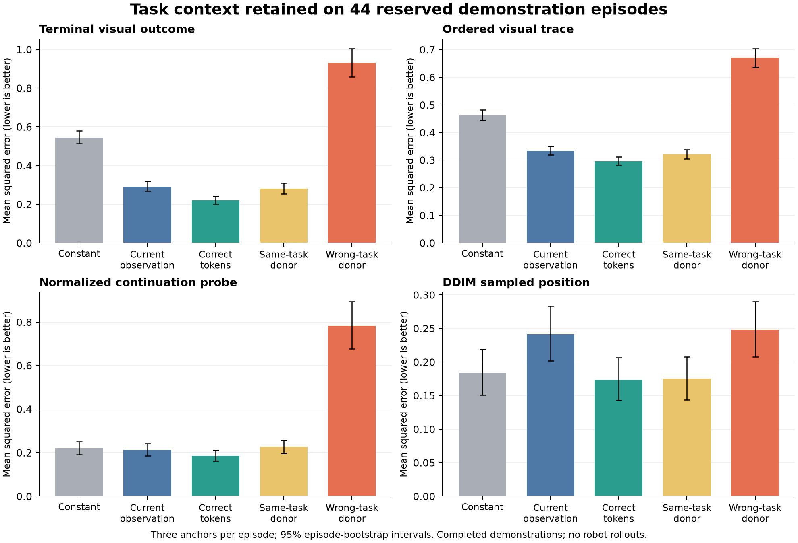

# Whole-demonstration task teacher: implementation and results

2026-10-20. **The first milestone passes its development and reserved-episode
confirmation gates.** A frozen four-token teacher retains useful task-specific
and episode-specific information from completed expert demonstrations. Causal
prefix inference and robot takeover have not been implemented or evaluated.

## Implemented artifact

- [Target dataset and provenance builder](../data/task_context_dataset.py), with
  a [CLI](../tools/build_task_context_targets.py).
- [Whole-episode teacher](../models/task_context_teacher.py), with four 128-D
  tokens, a two-layer width-256 bidirectional Transformer, ordered-quarter
  pooling, and a time-indexed reconstruction decoder. This decoder/readout
  structure is the selected refinement of the initial learned-query plan.
- [Training entry point](../training/train_task_context_teacher.py), using the
  existing diffusion U-Net plus a deterministic continuation diagnostic, observed
  outcomes, ordered visual/robot-state traces, and offline task-group supervision.
- [Paired assessment](../tools/assess_task_context_teacher.py) with separately
  trained current-observation and constant-context controls, natural donor-token
  interventions, task-ID templates, and a confirmation unlock tied to hashes.
- [Frozen-target exporter](../tools/export_task_context_teacher.py), requiring
  a passing confirmation result. [Commands and contracts](../tools/README_task_context_teacher.md).

This implementation is isolated from the production policy. It does not change
ALIGN's deployed action head, checkpoint interpretation, Mamba stream, or memory
bank. The deterministic regression head is a teacher-information probe, not a new
supported production action head.

## Data and supervision

LIBERO Goal supplies 428 episodes and 52,042 observations, with two cameras and
ten offline task groups. The cache's per-camera format, source path, dimensions,
and order were verified. Every real cached frame is retained; bounded extraction
stores CLS and 2x2 patch summaries. Positions/rotations are encoded using
translation and two rotation-matrix columns, avoiding equivalent-axis-angle
branch discontinuities.

The versioned episode split is **340 training / 44 development / 44 confirmation**,
stratified by hashed task group. Normalization and population/template targets
use training episodes only. Three evaluation anchors lie at 10%, 40%, and 70%
of the valid prediction-anchor range. Targets are contiguous eight-action chunks,
with no repeated terminal padding. The declared source rate is 20 Hz.

No text embedding or instruction enters the model. Source descriptions supply
offline group identities for stratification, contrastive supervision, donor
selection, and probing. This is not a claim of label-free training. The actual
continuous reconstruction/action targets come from demonstrations.

Important provenance limits are retained in the [source audit](../reports/task_context_teacher_20261020/data_audit.json):

- The used HDF5 export lacks success flags and approved terminal intervals.
  The last eight frames supply an **observed outcome**, not verified desired-goal
  GT. No automatic success labels were invented.
- It lacks measured gripper state and verified raw human commands. State uses
  the previous recorded gripper command, with an initial attribute/default 0.
  This is a causal command-history fallback, not physical measurement. The raw
  upstream schema lists two gripper channels, but these were dropped by the
  HDF5 converter and were not recovered/calibrated in this experiment.
- There are no object-pose, force, or verified task-event targets in this cache.
  Ordered targets describe realized visual and robot-state traces.
- Episode separation is verified; scene/operator/session separation is not.
  This is an existing-dataset research screen over known tasks, not the planned
  controlled ambiguous-history or fine-contact benchmark.

## Selection and preserved attempts

Each trained arm receives 80 epochs, 3,440 optimizer updates, batch size 8, four
training anchors per episode, and seed 42. Development selects checkpoints by
the predeclared mean of continuation, terminal, procedure, and robot-state error.
Confirmation never selects a model or changes hyperparameters.

| Candidate | Development gate | Reason |
|---|---|---|
| Learned global pooling, flat target decoder | Fail | Ordered visual-trace gain over current-only was 7.8%, below 10%. |
| Ordered-quarter pooling, flat target decoder | Fail | Visual-trace gain was 8.9%; all other requirements passed. |
| Ordered-quarter pooling, time-indexed target decoder | Pass | All original criteria passed; visual-trace gain was 12.5%. |

The last decoder makes local temporal evidence accessible to the auxiliary
heads. Both controls were retrained with that decoder. Quarter pooling is
exclusive to the full-teacher branch, so the earlier quarter-only ablation
could reuse the initial controls without changing their computation. Checkpoint,
target, and source hashes preserve these distinctions. Failed candidates remain
in the [artifact directory](../reports/task_context_teacher_20261020).

The selected model is epoch **78**, containing 6,417,066 parameters. Training
used approximately 346 MiB peak allocated CUDA memory, under a 24%-of-device cap,
while another training job remained active. This excludes CUDA/runtime overhead
and the pre-existing frozen-vision cache cost. The selected full-teacher run's
80 training epochs took about 177 seconds after setup/verification. Only one
training seed has been assessed; multi-seed architecture claims remain open.

## Reserved confirmation: 44 episodes

All milestone requirements also pass on confirmation without further tuning.
Metrics are episode-weighted MSE; lower is better. Feature/state scales are fixed
from training. The continuation probe is normalized by training action scale.

| Metric | Correct completed-demonstration tokens | Current-observation control | Reduction |
|---|---:|---:|---:|
| Observed terminal visual outcome | 0.22082 | 0.29151 | 24.3% |
| Ordered visual trace | 0.29611 | 0.33369 | 11.3% |
| Ordered robot-state trace | 0.06511 | 0.16364 | 60.2% |
| Normalized deterministic continuation probe | 0.18594 | 0.21246 | 12.5% |

Paired control-minus-teacher benefits have positive 95% whole-episode bootstrap
intervals: terminal **[0.05280, 0.09056]**, visual trace **[0.02814, 0.04729]**,
robot-state trace **[0.08248, 0.11614]**, continuation **[0.01088, 0.04233]**.
These are pointwise intervals from 10,000 episode resamples, not simultaneous
or training-seed uncertainty bounds. All three anchors remain in each episode
cluster. Constant-context outcome/trace controls are also beaten under the gate.

## Information interventions

The current input and target remain fixed while only the task tokens change:

| Token source | Normalized continuation MSE | Terminal MSE | Visual-trace MSE |
|---|---:|---:|---:|
| Correct episode | 0.18594 | 0.22082 | 0.29611 |
| Distinct same-task episode | 0.22621 | 0.28008 | 0.32043 |
| Different-task episode | 0.78182 | 0.93105 | 0.67127 |
| Training-average tokens | 0.44609 | 0.57549 | 0.47944 |

Wrong-task tokens increase continuation error **4.20x**. Their penalty exceeds
the same-task donor penalty by **0.55561**, interval **[0.45743, 0.65805]**.
This establishes task-specific content dependence rather than only a generic
nonzero-conditioning effect.

Same-task replacement also worsens continuation: **+0.04027**, interval
**[0.02557, 0.05539]**. Terminal and trace penalties are likewise positive.
The representation therefore contains useful episode-specific evidence beyond
a single group label. Because the encoder sees the completed realization,
this can include future-specific execution details; their inferability from a
human prefix is a question for the next milestone.

A train-only-fitted linear probe decodes the ten known task labels from tokens
at 100% balanced accuracy on confirmation, versus 90% from the learned current
summary. Chance is 10%. This is supplementary readability evidence, not an
intent-inference or task-completion success rate.

## Stronger controls and remaining limitations

The privileged known-task-ID terminal template achieves **0.24136** MSE. The
teacher's **0.22082** is better, with paired benefit **0.02054**, interval
**[0.01376, 0.02781]**. Together with within-task donor effects, this supports
retaining continuous context beyond a task ID.

However, the task-ID visual-procedure template is **stronger**: **0.24624** versus
the teacher's **0.29611**. The teacher does not dominate simple class templates
on every target. Ordered visual reconstruction and procedure abstraction remain
incomplete, and these data do not test same-endpoint/different-order constraints.

Actual ten-step DDIM sampling shows position MSE **0.17379** versus **0.24108**
for the current-only arm (27.9% lower); the paired benefit interval is
**[0.04732, 0.08768]**. Wrong-task tokens harm sampled position, but same-task
donor effects in the sampler include zero. Compared with constant context,
the sampled-position difference includes zero, rotation is worse, and gripper
differences include zero. Thus improved probe/outcome information does not
establish uniformly better generative control. No simulator or hardware
rollouts were run.

## Frozen outputs and verification

- [Frozen teacher checkpoint](../checkpoints/task_context_teacher_20261020/teacher_frozen.pt).
  SHA256: `1c872b39f44d910dca6ecd57217dd28f577a3a864b056de7ee507e19546f8910`.
- [Target manifest](../reports/task_context_teacher_20261020/targets/manifest.json).
  SHA256: `f5f54f2ac26fd957e0cfffc62558e9539a93d10c52d03e0b0018f259b4bc4dae`.
- [Development assessment](../reports/task_context_teacher_20261020/development_temporal_seed42.json)
  and [confirmation assessment](../reports/task_context_teacher_20261020/confirmation_temporal_seed42.json),
  with per-episode rows, donor IDs, checkpoint hashes, and paired contrasts.
- [Frozen latent manifest](../reports/task_context_teacher_20261020/frozen_latents/manifest.json):
  separate `(340,4,128)`, `(44,4,128)`, and `(44,4,128)` arrays for training,
  development, and confirmation. All exported values are finite. These are
  privileged supervision targets, never ready-made causal policy inputs.
- [Selection record](../reports/task_context_teacher_20261020/selection.json),
  source snapshots, initial gate protocol, and data audit preserve provenance.

Target/split integrity, train-only statistics, gripper timing, spatial ordering,
rotation equivalence, masked-NaN padding, current-only future isolation, label/
target input exclusion, real optimizer gradients, strict checkpoint roundtrips,
temporal decoder gradients, and confirmation/export gating are covered by the
targeted tests. Frozen-checkpoint source hashes match the current implementation.
The final targeted run passed **36 tests**. Export verification additionally
checked every latent file hash, all 428 finite token arrays, and split isolation.

**Disposition:** accept this teacher as useful completed-demonstration
supervision and keep it frozen. Next work is to determine how much of that
information a causal human-prefix encoder can infer at the intended handover
stage. The first milestone does not justify deploying autonomous takeover or
replacing Mamba with TTT.
