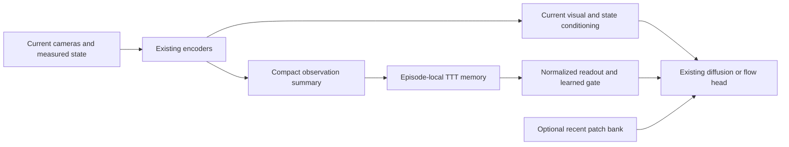

# Test-time training for ALIGN — 2026-10-19

**Recommendation: run a bounded TTT memory experiment; retain the existing architecture as the reference.** The most plausible use is an episode-local fast-weight memory that conditions the existing diffusion/flow policy. Mamba is the first possible replacement target. The episodic bank should remain available for recent spatial detail. Replacing the visual backbone, action generator, or shared-autonomy arbitration is not supported by this review.

This is a research assessment of checkout `e6449ddcbba39153738691e8a26a241c31bd8165`, including existing local research notes, against primary sources available on October 19, 2026. No TTT model was implemented, trained, or benchmarked. Existing local evaluator changes were preserved. Proposed benefits and engineering choices below are hypotheses for ALIGN, rather than measured improvements.

## 1. What TTT would mean here

Two different ideas share the name:

| Interpretation | What changes during deployment | Relevant question for ALIGN |
|---|---|---|
| Adaptation under distribution shift | A selected parameter subset learns from an auxiliary self-supervised task. | Can a deployment-specific adapter improve performance under changed appearance or dynamics? |
| TTT as recurrent memory | A small network's fast weights are the episode's recurrent state. Input-derived learning writes information into those weights. | Can a policy retain and use evidence of human intention or past task events better? |

The original TTT work updates models using unlabeled test inputs to improve distribution-shift robustness. This establishes the adaptation formulation, with image-classification evidence; it does not establish robot-control gains. [Sun et al., ICML 2020](https://proceedings.mlr.press/v119/sun20b.html).

TTT layers instead implement a recurrent sequence model whose hidden state is a linear model or MLP trained on the sequence itself. The 2024 work evaluates language models against Transformer and Mamba baselines. Its long-context results motivate an alternative memory mechanism; they cannot establish a failure threshold for ALIGN's Mamba1 encoder. [Sun et al., 2024; revised 2025](https://arxiv.org/abs/2407.04620).

For an initial ALIGN design, distinguish learned **slow parameters** from runtime **fast state**. Slow parameters learn across training episodes and stay fixed in deployment. Each episode receives an independent fast state initialized from learned weights. A deployed robot would update that temporary memory, rather than retrain its entire policy.

## 2. The most relevant evidence

| Primary source | Result or mechanism relevant to the decision | Transfer limit |
|---|---|---|
| [TTT-E2E, December 2025](https://arxiv.org/abs/2512.23675) | Meta-trained language-model weights absorb context through next-token prediction. The paper reports 2.7× faster inference than full attention at 128K context for its evaluated setting. | ALIGN has no equivalent stream of correct action labels. The reported speedup is against full attention, rather than its existing fixed-size Mamba/bank. |
| [RoboTTT, July 2026](https://arxiv.org/html/2607.15275v1) | TTT-MLP layers augment a GR00T N1.7 action expert. Context reaches 8K timesteps. Reported overall task-completion performance improves 87% relative to the single-step baseline; this is not an 87-percentage-point success gain. Long-sequence training combines action supervision and truncated backpropagation. | Strong direct robotics evidence, but a much larger model/data/compute setting. Pretraining uses 16 GB200 GPUs for 30K steps, followed by task-specific post-training. ALIGN has a U-Net action head, so the DiT insertion is not a direct code substitution. |
| [T²Mem, September 2026](https://arxiv.org/html/2609.36720v1) | Observation-derived fast-weight memory connects perception to action. It reports 56.83% average success on 16 RoboMME tasks versus 17.93% for its memory-free base. Its recipe includes a memory interface and alternating memory/policy optimization. | Particularly relevant to history-dependent decisions. Baseline table entries are partly imported from RoboMME, and the recipe uses 32 H200 GPUs for 48 hours. A generic TTT baseline in that table reaches only about 22%, emphasizing that inserting TTT alone is insufficient. |
| [VANE, August 2026, v2](https://arxiv.org/html/2608.09448v2) | Future visual prediction supports prompt adaptation. Candidate changes are evaluated against later observations before deployment. Benefits vary across embodiments and tasks. | Relevant to an eventual adaptation track, rather than evidence that fast-weight memory alone fixes appearance shift. |
| [Titans, 2025](https://arxiv.org/abs/2501.00663) | Combines neural long-term memory with local context; introduces mechanisms for managing memory updates and forgetting. | Supports investigating complementary memory timescales; its reported benchmarks do not validate ALIGN manipulation. |
| [Test-Time Training Done Right, 2025](https://arxiv.org/abs/2505.23884) | Identifies poor GPU utilization for small online updates and studies much larger update chunks. | A teleoperation loop cannot simply wait for thousands of future frames. Large-chunk throughput results do not predict single-observation latency. |

The 2026 robotics papers are recent preprints. Their results strengthen the case for an experiment, while leaving independent reproduction and transfer to ALIGN open.

## 3. What the current repository actually needs

**Mamba is optional and already streams.** In [the main model](../models/align_intention.py), `intention_encoder` exists only when history and intent tokens are enabled. [IntentionStream](../models/intention_stream.py) processes each real observation once. [IntentionEncoder](../models/intention_encoder.py) carries convolution/SSM state and forks it for intent-token readouts. Training uses a differentiable causal scan. TTT would therefore compete with functioning recurrent memory, rather than eliminate repeated whole-history computation that ALIGN necessarily performs today.

**The existing intention bottleneck is partly downstream of recurrence.** The [frozen usage assessment](intention_usage_assessment_2026_10_18.md) finds 97.5% task decoding from a train-only 128-D PCA of query outputs in both compression-64 models, versus 35.3%/54.8% from their learned final tokens. Natural other-task token substitutions barely alter pooled action error, and eight recent frames nearly reproduce full-history actions. These are expert-episode diagnostics, with potential scene/state shortcuts. They identify weak use of the learned intent representation without proving Mamba lacks capacity.

**The bank already has some content-dependent value.** The latest [memory work log](memory_adjustment_work_log.md) records corrected-coordinate handover results across two simulator seeds: 9/20 successes with trained memory, 7/20 with the same checkpoint's retrieval bypassed, and 6/20 for a separately trained no-memory policy. These small, development-selected results suggest limited, seed-dependent retrieval benefit. Earlier 0/10 tests using incompatible rotation coordinates should not drive an architecture replacement decision.

**Predictive supervision already exists.** [IntentionFuturePredictor](../models/intention_future.py) predicts future frozen CLS features, feature changes, and state changes at horizons 16/64 from intention alone. The [implementation report](intention_future_implementation_2026_10_18.md) documents only short optimizer smoke runs, with future prediction still worse than persistence. A quality-trained comparison of this cheaper change remains an important baseline. It is currently a training-only objective, rather than online TTT.

**Latency requires measurement.** A saved [historical benchmark](../results/inference_speed/run_6/results.json) reports 136.8 ms mean per step on an RTX 4060 Laptop GPU for one intent+memory diffusion configuration. This is not a fresh measurement of the current checkout, nor a TTT timing estimate. It does show why an added training computation needs an end-to-end latency budget. Profile vision, memory, and denoising separately on the intended deployment hardware.

The practical inference is that a more expressive memory may help, but ALIGN also needs an objective and conditioning interface that make historical information useful to the action head. Replacing recurrence while retaining the same weak readout can preserve the current failure mode.

## 4. Benefits worth testing

| Potential benefit | Concrete ALIGN example | Confidence before an ALIGN experiment |
|---|---|---|
| Longer retention of task evidence | A human approaches one target, then that target or distinguishing cue becomes occluded before handover. | Best-motivated hypothesis. Compare against Mamba and the repaired bank on identical histories. |
| Binding episode-specific information | Remember which container held an object or which task branch the operator chose. | Plausible; requires training where the earlier cue changes the later correct action. |
| Tracking phase and repeated events | Remember a completed grasp, placement, or repetition despite similar current observations. | Plausible, but temporal identity and selective forgetting require explicit evaluation. |
| Learning from operator corrections within a session | Adjust assistance after observing an intervention. | Requires correction-conditioned training and records that distinguish human corrections from the policy's own actions. Expert-only demonstrations do not establish this ability. |
| Deployment adaptation | Adjust a small adapter after observed transitions reveal changed appearance or actuation. | A separate, higher-complexity experiment with an appropriate predictive objective and delayed validation. |
| Bounded history storage | Summarize longer interaction prefixes without growing a raw observation buffer. | Structurally possible; existing Mamba and the capped episodic bank already have bounded state. Net speed/memory advantage remains unknown. |

Neither more memory nor an online reconstruction loss identifies a goal that has never been revealed. When two tasks have identical causal observations and operator behavior, ALIGN must retain uncertainty until new evidence arrives. TTT also does not create new manipulation skills or recover spatial detail absent from its input representation.

## 5. Which modules could it replace?

| Existing component | Assessment | Recommended disposition |
|---|---|---|
| Mamba intention/history encoder | Closest functional match: both produce a compact history-conditioned representation. | First replacement experiment, using an alternate backend and matched conditioning interface. Retrain; Mamba weights cannot be reinterpreted as TTT weights. |
| Cognitive/long-term part of episodic memory | Learned associations may summarize more observations than a short explicit bank. | Compare after the isolated temporal experiment. A hybrid may work better than removing all stored observations. |
| Perceptual patch bank | Fast weights compress detail and may interfere across similar observations. | Retain a small recent bank initially. Test delayed visual recall before reducing it. |
| DINOv2 and patch/state encoders | TTT is an update mechanism, not a substitute visual representation. | Keep the visual backbone fixed in the first experiment. Add a compact memory input projection. |
| Diffusion/flow action head | Memory and action distribution modeling serve different roles. | Keep the generator; let TTT supply history conditioning. |
| Future intention predictor | An auxiliary objective can train either Mamba or TTT representations. | Retain as an independent ablation. Deployment adaptation would require new runtime machinery. |
| Action-conditioned world model | TTT could adapt a residual or memory inside a transition predictor. | Later possibility. Associative reconstruction alone is not action-conditioned dynamics prediction. |
| Value/alpha/arbitration modules | Deciding when/how much to assist requires value, uncertainty, and intervention semantics. | No replacement case established. Better memory might improve their inputs. |

This mapping focuses on the active V4 intention path. The repository's separate [world model](../models/world_model.py) and older full-pipeline components should not be assumed to participate in every V4 rollout.

## 6. Proposed first experiment

Use a compact, gated TTT memory beside the existing current-observation path. In the first isolation experiment it supplies the temporal-conditioning slot while the Mamba branch is disabled. Keep the original Mamba configuration as a separate trained control. Test Mamba+TTT only if either provides a distinct measured benefit.



Start with per-camera CLS features plus state, normalized and projected to width 256. Preserve camera identity, visibility, and elapsed observation time. CLS-only memory is a bounded pilot: if the benchmark requires fine object identity that CLS does not retain, compare a small learned patch summary without changing the current spatial action path. Keep externally supplied task instructions out of the memory input for ALIGN's primary instruction-free setting.

A proposed linear fast model has four independent 64-dimensional heads and an output projected to the existing 128-D intention width. Its matrices contain `4 * 64 * 64 = 16,384` fast-state scalars: 64 KiB in FP32 per episode, excluding biases, projections, gradients, and other runtime tensors. A two-layer per-head MLP with 128 hidden units contains 65,536 matrix scalars, or 256 KiB in FP32. These are arithmetic state budgets, not measured VRAM or latency. Slow projections and training activation graphs can dominate them.

For the linear pilot, define `x_t` from the current observation and `W_t` as memory before that observation:

```text
q_t, k_t, v_t = learned_projections(x_t)
m_t = W_t q_t
condition_t = existing_condition_t + gate * project(normalize(m_t))
L_write = 0.5 * ||W_t k_t - v_t||²
W_(t+1) = W_t - eta_t * (W_t k_t - v_t) k_tᵀ
```

This specifies read-before-write semantics. The direct path supplies the current observation; the memory read supplies earlier context. Use the same convention in sequence training and streaming inference. A later write-before-read variant is a distinct experiment. The simple closed-form write avoids invoking general-purpose autograd for deployment updates; it is a proposed associative TTT variant, rather than an exact reproduction of the original layer's normalization and minibatch machinery.

Give memory a separately normalized projection into policy conditioning. Initialize its residual contribution small, while ensuring training can open the gate. Test against a Mamba control with the same normalization/projection so an interface improvement is not credited to TTT. A width-256 Mamba control also separates input compression from a recurrence change. An optional [Gated DeltaNet](https://arxiv.org/abs/2412.06464) control tests whether a simpler delta-rule recurrence achieves similar gains.

Train the slow projections, fast-state initialization, fusion, and policy through causal trajectory action losses. Do not train only on feature reconstruction: the relevant outcome is that a historical write improves a later action. Initially keep sequence lengths manageable. If using truncated backpropagation, carry fast-state values across segments and document that detachment limits credit assignment to distant writes. Compare a small alternating memory/policy training schedule if joint training fails; when freezing policy weights, preserve gradients through the policy to its memory inputs.

Implementation would need a dedicated memory module and backend selection in `align_intention.py`, training support in `train_intention.py` and the cached ablation runner, state handling in `IntentionStream`, and reconstruction support in checkpoint loaders and both evaluators. The proposed flags/interfaces are design work, not existing runnable options.

The official [TTT PyTorch repository](https://github.com/test-time-training/ttt-lm-pytorch) is a useful reference but explicitly warns that its unoptimized training is slow. The [inference kernel repository](https://github.com/test-time-training/ttt-lm-kernels) targets language-model benchmarks. Neither establishes compatibility or acceptable batch-one robot latency in ALIGN's environment. Reuse the mechanism selectively after checking numerical and training-gradient parity.

## 7. Runtime and training contracts

1. **Independent episode state.** Reset fast weights for each episode and each vectorized environment independently. Preserve an observed human prefix across the human-to-model handover. Save learned initialization in ordinary checkpoints; keep live episode state separate.
2. **One write per scheduled real observation.** Do not write repeated padding, reread overlapping training windows, or perform ten writes because denoising has ten solver steps. Hold the memory snapshot stable during an action-sampling call. Advance memory during observed prefix/action-execution frames according to the same cadence used in training.
3. **Causal information only.** Current expert action chunks belong only to the outer training loss. A future observation can supervise an online update only after it actually arrives. Never use the policy's generated action as an assumed correct expert label.
4. **Missing observations retain their meaning.** Mask unavailable modalities in write inputs and losses. A missing camera should not overwrite a valid visual association with zeros. Retain timestamps and test long outages. Write cadence changes the effective memory timescale.
5. **Stable temporary updates.** Normalize keys/values, bound learned step sizes, check finite state, and measure interference from repeated or conflicting observations. Add forgetting/decay only as an explicit ablation: it can erase the very cue the task requires.
6. **Keep the right gradient paths.** Existing observation/validation paths use `torch.no_grad()`. A nonlinear update using autograd needs a narrowly enabled gradient region. A functional linear write works without deployment autograd, while training must retain the computation graph through writes within the chosen gradient horizon. Do not detach every write by copying the explicit bank's storage convention.
7. **Separate fast state from model parameters.** Deployment updates should not mutate the shared policy, leak across batch elements, or accumulate graphs indefinitely. Async inference requires an explicit state version/snapshot so memory cannot change halfway through sampling.

## 8. A separate adaptation experiment

Do this only after deciding whether the target problem is memory retention or deployment shift. A possible adaptation track updates a small feature adapter or transition-model residual from observed `(observation_t, executed_action_t, observation_(t+1))` tuples. Hold a stationary target encoder fixed and compare against a frozen adapter and the same offline-trained objective without runtime updates.

The existing intention future objective could supply a training scaffold, but its current intent-only predictions are not conditioned on the executed action, and no delayed runtime target queue or optimizer is implemented. A lower predictive loss can follow easier trajectories or feature collapse without improving control. Candidate adapters should therefore be evaluated on subsequent, disjoint observations before activation, following the proposal/validation principle in VANE. Even accepted predictive updates require closed-loop success evaluation.

This track could eventually address actuation or appearance mismatch. It is more invasive than temporary associative memory, and it should not be combined with the first memory experiment because the cause of any gain would become unclear.

## 9. Evaluation that can support adoption

First establish tasks where identical current observations require different actions because of an earlier cue: occluded target choice, counted repetitions, conflicting demonstration prefixes, and a human-selected branch before handover. Standard LIBERO Goal results remain useful for regression, but task decoding from late expert frames alone is insufficient evidence of memory. Add a deployment-shift suite only for the adaptation track.

Use a staged comparison to control compute:

| Stage | Arms | Decision resolved |
|---|---|---|
| 1: controls | Current-only/short-history; existing Mamba; Mamba with normalized conditioning and a properly trained future objective; selected repaired-bank policy. | Whether cheaper objective/interface work already resolves the issue. |
| 2: isolate TTT | Compact TTT-Linear versus compact Mamba, with identical current paths, readout width, data, observation cadence, action supervision, and auxiliary-loss setting. | Whether the memory mechanism adds value. Report parameter count and training compute separately. |
| 3: capacity and combinations | TTT-MLP if linear memory shows promise; TTT plus a small recent bank; Mamba+TTT only when complementary. | Whether additional capacity or complementary memory is worthwhile. |

For each trained memory policy compare correct history, conflicting history, no writes from learned initialization, periodic reset, and readout bypass. Preserve the direct current path and matched sampling randomness. A no-write condition preserves learned initialization and the readout computation, separating online learning from static extra capacity. Use multiple training seeds for promoted candidates and reserved simulator scenes/episodes for final testing.

Report closed-loop completion, wrong-target choices, operator corrections, gripper transitions, action smoothness, motion/rotation error, and memory-content interventions. Measure p50/p95 end-to-end latency, update latency, peak VRAM, and cost across increasing observed history on deployment hardware. Keep action horizon and observation/write cadence fixed. Use paired task/scene seeds and confidence intervals; choose evaluation volume for a prespecified minimum useful effect instead of treating a ten-episode sample as decisive.

**Adopt TTT only when all three conditions hold:** meaningful closed-loop improvement over the strongest matched simpler control; interventions demonstrate benefit from correct historical content; and latency/precision regressions fit the actual application budget. Better feature reconstruction, cluster separation, or task decoding alone does not meet that standard.

The recommended order is to complete the cheaper intention-objective/conditioning baseline, then test a small gated TTT backend. Promote it to replace Mamba only after a matched win. Consider reducing the episodic bank only after a hybrid comparison shows that losing explicit visual detail is acceptable.
